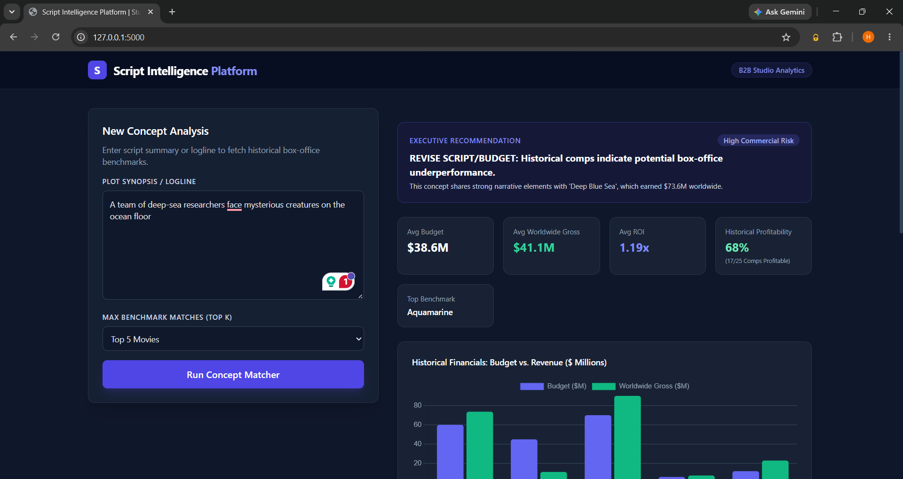
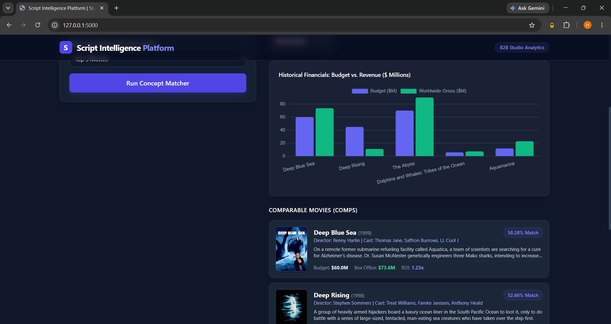
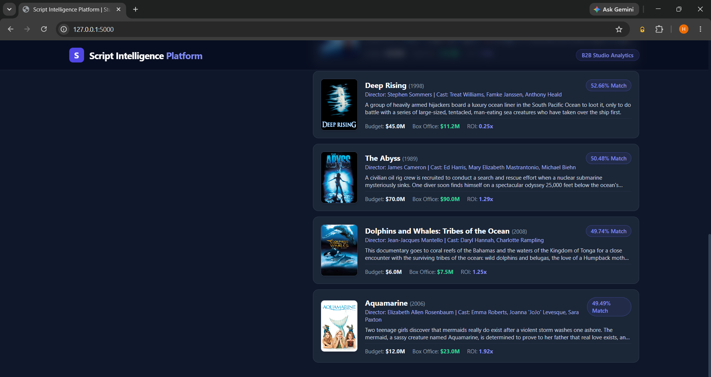

# Script Intelligence Platform 🎬

An AI-powered script analysis and semantic concept matching platform that helps screenwriters, producers, and studios evaluate story concepts against historical movie datasets, predict potential ROI, and analyze commercial risk.

## 🚀 Features
- **Semantic Similarity Search:** Finds top comparable movies using ChromaDB and Sentence-Transformers (`all-MiniLM-L6-v2`) based on narrative plot summaries.
- **ROI & Financial Benchmarking:** Calculates average budgets, worldwide revenues, and historical success rates.
- **TMDb Integration:** Fetches real-time movie posters and metadata dynamically.
- **Qualitative Risk Assessment:** Generates executive recommendations and risk levels based on historical comps.

---

## 📊 Dataset & Processing
The platform is powered by a custom-curated historical movie dataset located in `data/processed/`. 
- **Data Pipeline:** Raw movie data is cleaned and structured using custom Python scripts (`scripts/build_dataset.py`).
- **Vector Indexing:** The plot summaries and metadata are embedded and indexed into a local **ChromaDB** vector database via `scripts/index_vectors.py`.
- **Metrics Tracked:** Each record maps out critical financial and narrative attributes including production budgets, worldwide box-office collections, ROI calculations, and genres.

---

## 📸 App Preview
Here is a quick look at the platform in action:

### 1. ROI & Risk Metrics

### 2. Comparable Matches & Posters

---

## 🛠️ Tech Stack
- **Backend:** Python, Flask (`3.0.2`)
- **Vector Database:** ChromaDB (`0.5.x`)
- **ML / NLP:** Sentence-Transformers, PyTorch
- **APIs:** The Movie Database (TMDb) API

---
